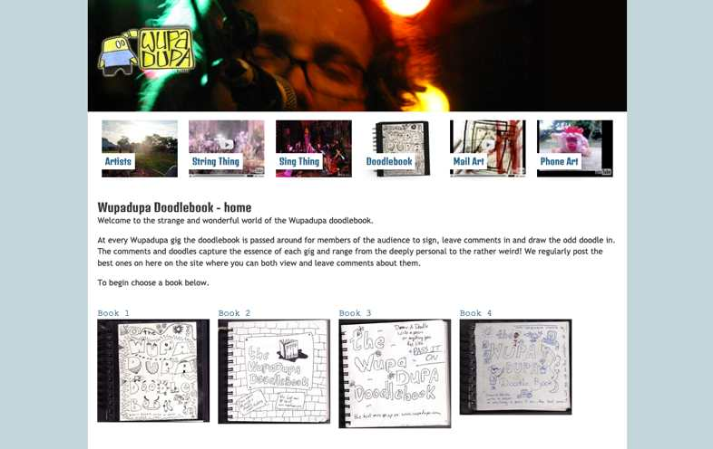
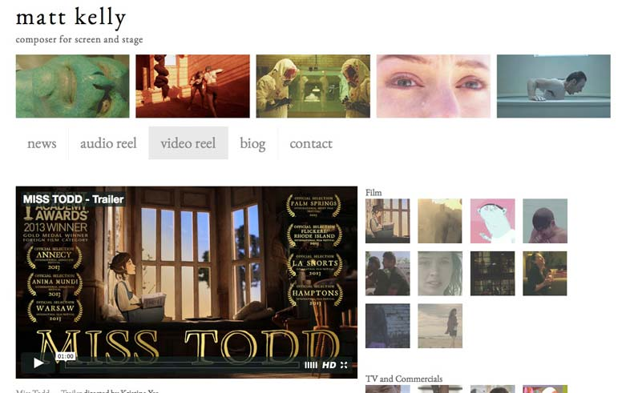

I'm a frontend engineer with over 20 years' experience building and designing websites, the last 11 of them at Tripadvisor. I specialise in React, Next.js, TypeScript and Tailwind, and I'm comfortable taking a feature all the way from a Figma design to production, running it as an A/B test and rolling it out.

Below is a selection of sites I've worked on, from my day job to charity and personal projects. I design and build my own sites with [Eleventy](https://www.11ty.dev/), hand-coding the HTML, CSS and JavaScript.

## Professional work

### [www.cruisecritic.com](https://www.cruisecritic.com/ "Visit www.cruisecritic.com")

One of the world's largest cruise review and planning sites. From 2020 to 2026 I was a core engineer on the product team. I worked on almost every part of the frontend, including search, deals, ship pages, booking, the My Cruise trip planner and site-wide dark mode. I also built shared components for the design system and ran dozens of A/B tests.
 

**Tech:** Next.js (App Router, Server Components), React, TypeScript, Tailwind CSS, Radix UI, GraphQL, Storybook, Playwright

## Websites I have designed and coded

### [www.africanvision.org.uk](https://www.africanvision.org.uk/ "Visit www.africanvision.org.uk")

The website for the charity African Vision Malawi, which I build and maintain as voluntary work. I was responsible for the design, coding and structure of the site, and for rebranding it after the charity changed its name. It is now an Eleventy static site with Markdown content and responsive images, hosted on Netlify.

**Tech:** Design, Eleventy, Markdown, responsive images, Netlify

### [www.littlemusiclist.com](https://www.littlemusiclist.com/ "Visit www.littlemusiclist.com")

A personal project: an ever-growing collection of music pairings. If you like this song, you might like this other one too. You can read more about how it started in my [Little Music List blog post](/blog/little-music-list/).

**Tech:** Design, Eleventy, Markdown

### [www.sugardrum.com](https://www.sugardrum.com/ "Visit www.sugardrum.com")

My own site, created to showcase my music. It started out on WordPress, [moved to Jekyll](/blog/2016/12/09/moving-from-wordpress-to-jekyll/) and has recently been rebuilt with Eleventy.

**Tech:** Design, Eleventy, Markdown

### [www.wupadupa.com](https://www.wupadupa.com/ "Visit www.wupadupa.com")

An older site that I converted to GatsbyJS. I liked the slightly retro and simple styling of the original so kept most of it, but made it load faster, made it more accessible and made the layout fully responsive.

**Tech:** Design, SASS, GatsbyJS, React, Markdown

## Websites I have coded from someone else's design

### [www.matthewjameskelly.co.uk](https://www.matthewjameskelly.co.uk/ "Visit www.matthewjameskelly.co.uk")

Website for the BAFTA award-winning film composer.

**Tech:** Jekyll, LESS, jQuery

